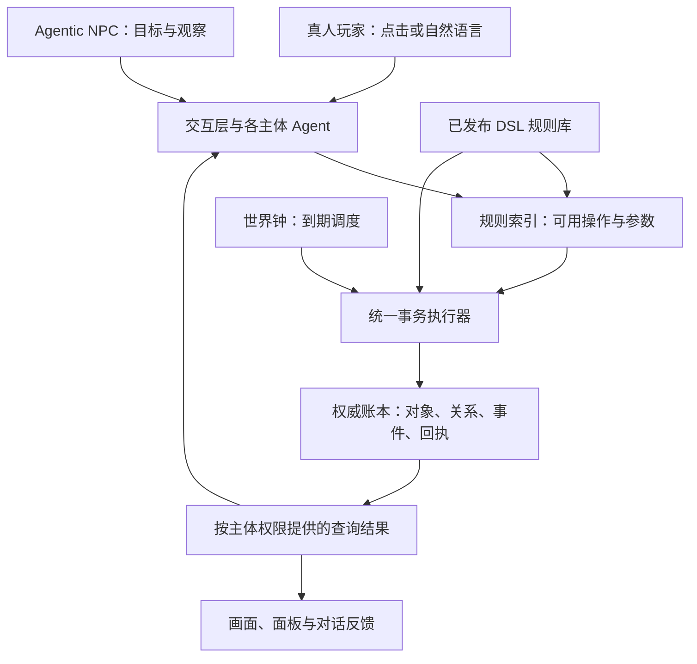
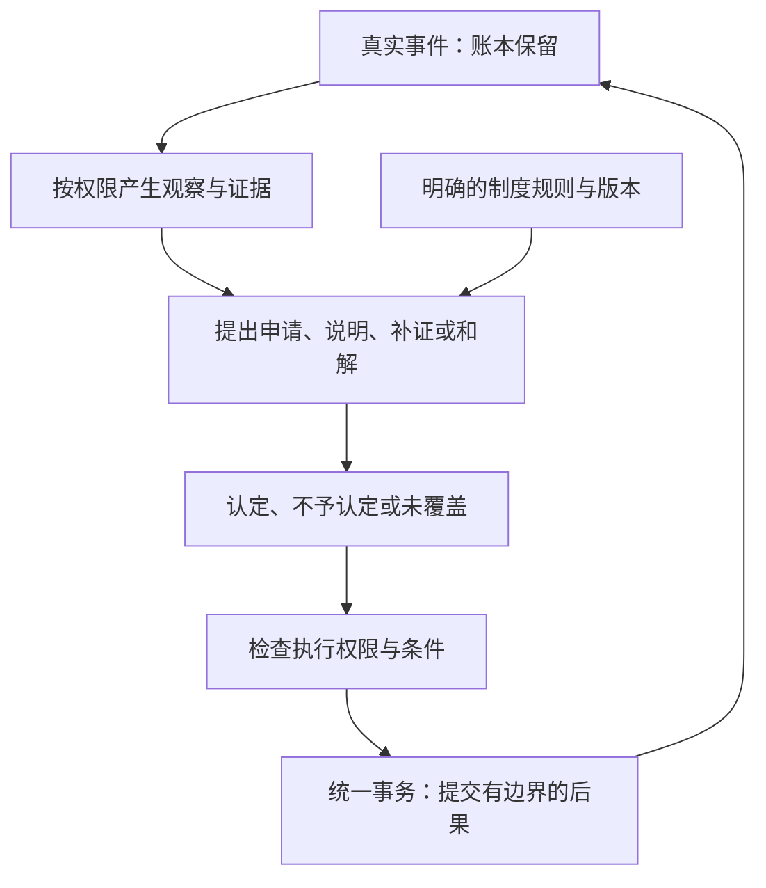

# Worldgraph：规则驱动的多人沙盒结构介绍

版本：介绍稿 v0.2  
日期：2026年10月29日  
用途：向产品、开发、美术与内容创作者说明系统结构及其协作方式。

本文根据 Worldgraph《规划 v0.3》及后续讨论整理。基础架构来自现有规划；“有限信息与社会制度”保留为扩展备忘，本阶段暂缓。本文描述设计，不代表所有模块已经实现或完成验证。

### 当前阶段的推进重点

根据10月29日本轮提供的王星会话截图，当前先围绕**可维护、可扩充的交换规则＋时间维度＋地图点**推进，以基础经济活动承载游戏性。

- 初期商店、工厂等设施由官方提供，先让基本资源与交易流程成立。
- 法律、案件处理和复杂观察机制暂缓，不作为当前起步前置条件。基础资源授权与主体访问边界仍需成立。
- 官方运营事件和主题世界可以作为后续内容方向；截图提及魔法、外星、蒸汽朋克等可能性，尚未选定具体题材、数量或运营计划。
- 先前提出的问题保留为实现核对与验证事项，不要求全部先形成书面答复再开工。本轮结论收敛优先级，没有完整重定原规划的全部开发细项。

## 1. 我们希望建立什么样的世界

Worldgraph 是一个由明确规则支撑、真人玩家与智能体居民共同参与的持续性沙盒。

玩家可以探索地点、获得资源、使用设备、生产物品、交易、合作，并逐步参与或创造新的活动。世界会保留物品、持有关系、已发生事件和操作结果，使不同参与者面对同一个持续变化的状态。

世界内容以现实生活的简化切片为基础，也可以包含明确标注的神话、科幻或用户自创规则。每个切片只需要覆盖自己承诺的行为范围，并与共同的资源和权限约束保持一致。

整个结构围绕一个原则组织：

> Agent 理解意图、寻找规则并发起操作；规则引擎校验操作，权威账本保存实际结果。

玩家可以通过自然语言表达意图，也可以通过点击、选择对象等世界交互触发操作。Agent 叙述必须与已提交的世界状态相符。

## 2. 结构总览

基础结构分为内容生产、运行时交互、世界执行三部分：

| 部分 | 主要职责 |
| --- | --- |
| 内容生产 | 定义物质、设备、实体、地点和具体工艺；官方 Agent 可辅助生成 DSL 候选 |
| 运行时交互 | 理解玩家意图或 NPC 目标，查询规则索引，取得获准信息，选择已有操作 |
| 世界执行 | 校验权限、对象、资源、位置和时间，提交事务，保存事件与结果 |



图中的基础主体权限仍需成立；调查、秘密和制度裁定所需的复杂观察条件后置。各 Agent 按自己的主体运行，不共享彼此的私有上下文。真人与 NPC 共用操作机制，但不同主体可以拥有不同的信息与资源权限。

## 3. 世界的基本组成

世界可以理解为一张由对象和关系构成的图。规则负责按条件改变这张图。

### 3.1 类与实例

**类（Class）**说明某种东西是什么，例如铅、木材、坩埚、运输车。官方类与用户创造类具有不同的命名和适用范围。

**实例（Instance）**是世界中实际存在的某一件东西。每个实例有唯一 ID，以及类型、状态和相应属性。运行时提交具体实例 ID，而不只是“我有三块铅”这样的文字声明。

实例 ID 不复用。规则可以声明生成新产物、消耗材料或让设备退役；这些变化必须留有来源与记录。“守恒账本”并不意味着所有物品的件数永远不变。

### 3.2 物主、所有权与持有

**物主（Owner）**是参与操作、持有资源的主体。真人玩家与 Agentic NPC 使用相同的主体模型；商店、工厂和自然实体也可以管理自己的储备。

**持有关系（Custody）**表示一个实例当前由谁或什么容器、实体、托管过程持有。单个实例不能同时被两个主体独立使用。

所有权、当前持有和使用许可需要分别表达。例如租借坩埚时，借用者在租期内持有并按许可使用设备，不能据此理解为获得永久所有权或任意转借权。具体权限字段与到期冲突处理仍需对齐。

### 3.3 实体与账户

**实体（Entity）**是世界中的规则承载者，例如商店、工厂、银行、矿脉或用户建立的设施。它可以拥有库存、挂载规则，并声明操作的适用条件。

**账户（Account）**连接某个物主与某个实体，可以保存该关系下的交易记录、信用、许可等信息。

按当前规划，支付通过物质实例转移完成，账户不再额外承载法定货币余额。使用某种商品支付，意味着对应实例按交易规则转移给接收方。

### 3.4 地点与路线

**地点（Location）**表示城镇、矿区、工坊等位置；**路线（Route）**表示地点之间怎样连通，以及移动需要的时间、体力和运输条件。

物品可能在角色身上、容器里、某个地点或运输途中。它的有效位置必须能从持有关系与位置记录中唯一解析，不能同时出现在两个可使用的位置。

## 4. 通用 API 与 DSL 怎样配合

“固定编码”指低频更新的执行结构。例如，组装操作统一处理输入、设备、产出、损耗、时间与折旧；具体工艺使用 DSL 填写。

**DSL 是遵循固定格式的规则说明。**它让不同配方共享同一套执行机制。

以此前讨论中的虚构炼金配方为例：

| 项目 | 规则内容 |
| --- | --- |
| 材料 | 铅×3、汞×2、木×1 |
| 设备 | 坩埚，调用者在有效许可内持有 |
| 消耗品 | 汞与木完全耗损 |
| 产出 | 黄金×1 |
| 时长与折旧 | 由该配方具体声明 |
| 执行地点 | 指定炼金实体，或由规则允许便携执行 |

这是游戏规则示例，不是现实化学工艺。运行时必须绑定对应的材料和设备实例，由系统检查实际状态。

当前规划中的主要动词包括：

| 动词 | 用途 |
| --- | --- |
| Assemble | 组装、加工、化合 |
| Disassemble | 拆解和回收 |
| Exchange | 有对价的交换 |
| Transfer | 赠与、转移、进入托管等 |
| Offer / Accept | 提出并接受明确交易条款 |
| Move / Transport | 主体移动与货物运输 |

这些动词在 API 索引中分别呈现，底层共用统一事务执行器。“交换”在架构层指受约束的状态变化，不要求所有行为都以买卖的形式呈现给玩家。

DSL 可以扩展已支持语义下的内容。新内容需要尚未实现的操作、证据或效果时，仍需扩展机制；不能通过一段规则文字获得任意执行能力。

## 5. 一次操作怎样发生

以“使用工坊把材料加工成物品”为例：

1. **表达意图**：玩家选择工坊、材料和设备，或向 Agent 描述目标。
2. **查找规则**：根据工坊、材料、目标产物和已有权限，找到可用配方。
3. **绑定实例**：选择实际材料、设备和相关账户，形成结构化调用。
4. **执行前校验**：检查规则版本、资源状态、授权、有效位置、使用许可及其他前置条件。
5. **提交变化**：即时操作一次完成；有时长操作先进入规定的进行中状态，将占用资源托管，再按到期规则结算。
6. **返回结果**：产生实际物品或明确拒绝原因，保存回执，更新画面与对话。

引擎需保证每次状态提交的原子性，以及有时长操作各阶段之间的合法转换。多人争抢同一材料时，只能有规则允许的一方成功；重复提交同一操作应返回原结果，避免重复消耗和产出。

涉及商店库存、自然储备或其他主体托管资源时，需要分别验证其授权来源。多方输入协议、加工跨越设备租期、取消与到期的排序，是当前仍需补齐的具体合同。

## 6. Agent 在世界里的职责

运行时 Agent 的主要工作是：

- 理解玩家目标，或根据 NPC 目标提出行动；
- 查询自己有权读取的对象、位置、规则和记录；
- 通过索引选择可用操作，填写参数并调用；
- 根据实际结果解释发生了什么，帮助形成下一步选择。

Agent 的描述不能代替物品、合同或操作回执。规则中没有的动作不能靠自然语言直接执行；操作失败后，也不能叙述成已完成。

官方内容生产 Agent 则承担另一种职责：辅助整理知识、提出物质和工艺规则，并生成校验案例。候选内容经过约定的校验与发布流程后，才进入运行时规则库；具体审核与启用机制尚需确定。

体力可以约束游戏内行动产出，但不能单独约束所有模型思考、查询和失败重试。模型调用的频率、并发和预算需要独立管理。

## 7. 多人、时间与空间怎样共同作用

### 多人共享

参与者共享同一权威状态。别人已经买走的货物、托管中的材料、正在使用的设备，都不能因另一段对话而重新变得可用。

共享状态也支持私人关系和有限信息：所有人生活在同一世界，不意味着所有人都能查询他人的全部库存、合同和观察。

### 世界钟与体力

世界钟以粗粒度 tick 调度加工完成、运输到达、租期回转和托管超时。体力作为物质，被行动消耗，并由明确恢复规则补充。

二者分别表达“结果何时兑现”和“主体能承担多少行动”。时间推进本身不强制所有物品老化；腐烂、磨损或其他时间效果由具体规则定义。

### 空间与展示

地点图与路线成本能够表达资源分布、旅行、运输和区域差异。场景美术、角色动画和界面负责将这些状态变为玩家可理解的空间体验。

若采用可自由行走的场景，还需明确地点内部的对象位置、接近条件、入口和碰撞与权威操作的映射。坐标不能只是看起来接近，后台却认为不可操作；也不能让纯展示变化擅自改变规则资格。

当前规划先建立空间机制、后扩展渲染。具体画面接入时机和最终交互形态仍待产品侧对齐。

## 8. 用户创造怎样进入世界

用户可以按允许范围建立实体、定义工艺和创造新物质类。相关内容标注用户来源，其他主体在获准条件下调用。

以 ElementX 为例：

```text
投入：3石头 + 2木头 + 1铝镁合金
其中木头是工艺消耗品
产物可回收组成：3石头 + 1铝镁合金
```

用户可以定义只回收其中一部分的工艺，但不能拆出超过实际组成的官方材料，也不能取回已经消耗的木头。

ElementX 可以在用户子世界中具有自定义用途和价值。官方工艺仍按明确的材料类型要求执行；即使它被描述成纯金，也需要先合法拆成官方金实例，才能进入要求金的官方工艺。

需要保留每个实例实际形成时的组成，并正确处理嵌套、多个产物、部分拆解和配方更新。用户规则的适用范围受到限制，但其资源消耗与交易仍会影响共同经济。

## 9. 后续扩展备忘：社会制度（本阶段暂缓）

**本节保留此前讨论供后续参考。本阶段不推进法律、案件或复杂观察机制，也不将下面的租借争议作为已选首个切片。**

生产与交易之外，世界还可以表达借用约定、交付责任、地方许可和有限纠纷处理。这些机制服务于一个容易理解的虚构社会，不承诺完整模拟现实法律。

建议区分四类状态：

| 状态 | 表达内容 |
| --- | --- |
| 权威事实 | 世界实际发生的动作与结果 |
| 角色认知与证据 | 各角色获准知道、声称或能够提交的内容 |
| 制度规则 | 某实体或地区允许的行为、责任条件与处理程序 |
| 案件与执行状态 | 申请、补证、和解、认定、待执行及已执行结果 |



“系统有完整日志”与“所有角色全知”分别处理。裁定者也只能使用制度允许的证据。LLM可以协助问话、说明和提出允许的和解方案，不能临场补事实、补规则或任意处置资源。

### 逃脱制裁的条件

如果选择这类玩法，可以将发现、认定、执行分别设定为有条件的过程。真实违规可能未被发现，或现有证据不足以认定，也可能尚不满足执行条件。

这些情况不改变权威事实。新证据是否能重新启动程序、结果是否可复核，须由既定规则决定。玩家需要能理解并影响过程，不能仅依靠后台随机放行。

自动合同仍按原约定执行。例如到期归还和已经确定的托管结算，不应临时交给模型撤销。额外责任与已结算部分必须分开，防止重复处置。

### 示例：租借工具后的损坏争议

```text
正常借用与使用
    → 归还时出现损坏
    → 核对约定和获准证据
    → 说明、补证、和解或请求裁定
    → 产生规则允许的补偿或资格变化
    → 玩家继续生活
```

该例用于解释结构，尚未选定为首个实现切片。执行所能影响的押品、物品或服务资格必须有明确授权，不能因为引入制度就赋予机构无限权限。

## 10. 规则如何持续扩展

规则生产与实际游玩分开组织：

1. 明确一个活动切片及其覆盖范围。
2. 选择已有的操作模板；制度模板属于后续扩展方向。
3. 由创作者或 Agent 填写具体规则、内容和例子。
4. 校验类型、资源、权限、时间、空间与版本关系，并检查正常、失败和恢复案例。
5. 按约定流程发布，供运行时检索与调用。
6. 根据实际游玩反馈修订后续版本，保留既有记录与结果的解释方式。

扩展速度来自通用机制与内容数据的复用。物质类、工艺和地点可以逐步增加；引入新的机制语义仍然需要设计与实现。可表达、可执行和好玩，需要分别验证。

## 11. 当前设计状态与待对齐项

| 内容 | 当前状态 |
| --- | --- |
| 当前优先级 | 先推进可维护、可扩充的交换规则、时间维度与地图点 |
| 初期商店、工厂等设施 | 由官方提供；具体内容清单和运营安排待细化 |
| 统一事务、API／DSL、物品实例、实体／账户 | 已写入 Worldgraph v0.3 规划，尚未按源码核实实现 |
| 物质支付、世界 tick、体力与地点图 | 已有规划和讨论说明，参数及部分合同待细化 |
| 官方内容生产与 UGC | 已有路线图与约束方向，实际管线和全生命周期校验待核实 |
| 复杂观察、证据、案件与制度执行 | 本阶段暂缓，作为后续扩展备忘保留 |
| 官方事件与主题世界 | 后续内容方向，具体题材与计划未定 |
| 空间机制与可走动画面的衔接 | 需要进一步定义 |
| 玩家理解、经济表现和持续趣味 | 尚无本结构的完整运行验证证据 |

当前按基础交换、时间与地图方向推进，用小范围经济活动验证机制与体验。多方资源授权、时序冲突、模型调用边界、用户物质回收和场景映射等疑问保留为相应实现阶段的核对项，不能据“无需先答复”记为已解决。该结构是否融回现有海湾、作为独立模式或独立产品，尚未确定。

## 12. 相关资料

- [Worldgraph 原规划 v0.3](参考资料/rpg-sandbox-initial-20261028/规划.md)
- [时间讨论](参考资料/rpg-sandbox-initial-20261028/时间讨论.md)
- [地图讨论](参考资料/rpg-sandbox-initial-20261028/地图讨论.md)
- [货币讨论](参考资料/rpg-sandbox-initial-20261028/货币讨论.md)
- [给王星的机制与社会系统讨论说明](plans/worldgraph-note-for-wangxing-20261029.md)
- [简化制度方案选项](plans/worldgraph-institution-options-20261029.md)

## 13. 版本更新

- **v0.1，2026-10-29**：根据初期规划与讨论整理基础结构，附社会制度扩展建议。
- **v0.2，2026-10-29**：依据本轮王星会话截图收敛阶段重点：交换规则＋时间维度＋地图点；初期设施官方提供，法律与复杂观察暂缓。此前讨论作为备忘保留，未据此判断实现已完成。
